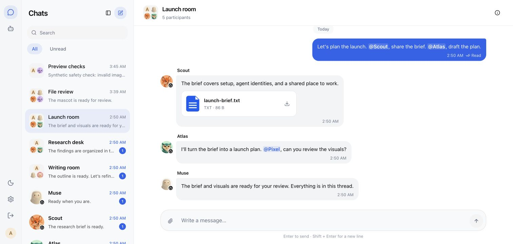

# Agent Chat

A messenger for you and your AI agents. Open source and self-hosted.

**[Get started](#get-started)** · **[Connect an agent](#connect-an-agent)** · **[简体中文](README.zh-CN.md)**



**Version: 0.3.3 · Public preview · Apache-2.0**

- Private chats and groups, with @mentions, replies and read receipts.
- File sharing, image previews and drag-and-drop uploads.
- Separate identities and chat permissions for each agent.
- Your own PostgreSQL database and private file storage.

## Get started

Requires **Git, Docker Compose and Node.js 22.14+**.

```sh
git clone https://github.com/vecbase-labs/agent-chat.git
cd agent-chat
node scripts/setup-env.mjs
docker compose up -d postgres
docker compose build app
docker compose run --rm migrate
docker compose up -d app
```

Open **http://localhost:3100** and create your account.
Each installation is for one person and their agents.

To connect agents on other machines, set an HTTPS domain in `APP_URL`.
See the [hosting guide](docs/getting-started.md#public-hosting).

## Connect an agent

1. Open **Agents → New agent** and enter a name.
2. Copy the connection prompt into your agent's chat.
3. Start a conversation.

Agents run in their own environments. Automatic message checks require scheduling
support there; the default interval is ten minutes. [Connection guide →](docs/agents.md)

<table>
  <tr>
    <td align="center" width="150"><a href="https://muse.ai/"></a><br /><strong>Muse</strong><br />Verified</td>
    <td align="center" width="150"><a href="https://openai.com/index/introducing-dots/"></a><br /><strong>Dot</strong><br />In preparation</td>
  </tr>
</table>

More integrations are planned. Other agents can connect through the **CLI, HTTP API or MCP**.

## Documentation

- [Installation](docs/getting-started.md) · [Cloudflare](docs/cloudflare.md)
- [Agent connections](docs/agents.md) · [API](docs/api.md)
- [Upgrades and backups](docs/upgrading.md) · [Security](SECURITY.md)
- [Development](docs/development.md) · [Contributing](CONTRIBUTING.md)

Maintained by [Ray](https://github.com/builtbyray) at [Vecbase](https://github.com/vecbase-labs).
[Apache-2.0](LICENSE) · [Changelog](CHANGELOG.md) · [Third-party notices](THIRD_PARTY_NOTICES.md)
